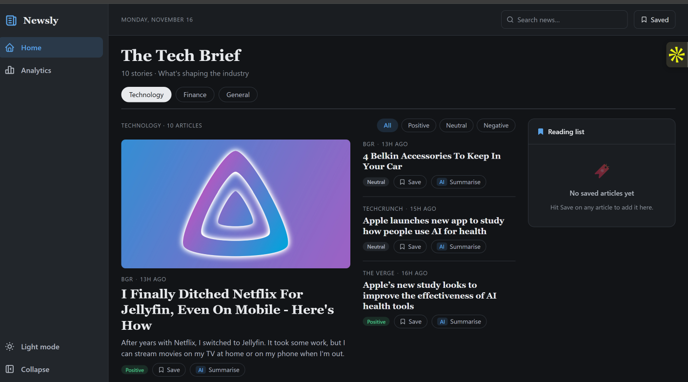
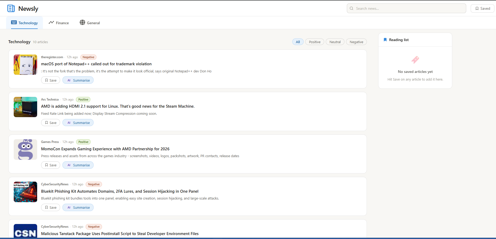

# 📰 Newsly (Focused News Aggregator)

A full-stack web application that aggregates news by category, classifies every headline as positive, neutral or negative with AI, generates AI-powered summaries, and lets you save articles for later reading. An Analytics tab built on the sentiment data is in progress.

---

## 🚀 Features

### 🔹 Core Features

* Fetch news from multiple categories:

  * Technology
  * Finance (Business)
  * General
* Display articles in a clean, card-based UI
* Search articles by keyword
* Save articles to a reading list (kept in the browser session for now)
* Loading and empty states

### 🔹 AI Features

* 🤖 Automatic sentiment label on every article (positive, neutral, negative)
* 📝 AI-powered article summaries (3 bullet points) on demand
* ⚡ Server-side caching, so the same headlines and articles never hit the AI twice

### 🔹 Navigation and Analytics

* Navbar with **Home** and **Analytics** pages
* Reusable `StatCard` tiles showing total, positive, neutral and negative counts
* `useSentimentStats` hook that derives the counts in one pass, ready to reuse across pages

---

## 🛠️ Tech Stack

### Frontend

* React (TypeScript, Create React App)
* TanStack React Query
* React Router
* Axios
* CSS Modules

### Backend

* Node.js
* Express
* Mongoose (optional MongoDB variant)

### APIs & Services

* GNews (news data, called only from the server so the key stays private)
* Google Gemini (sentiment and summaries)

### Hosting

* Client on Vercel
* Server on any Node host (Render's free tier works; it sleeps after idle, so the first request can be slow)

---

## 📁 Project Structure

```
news-aggregator/
  client/
    src/
      components/    # ArticleCard, ArticleList, CategoryTabs, Header, SavedSidebar, StatCard
      hooks/         # useSentimentStats
      pages/         # AnalyticsDashboard
      services/      # api.ts, all calls to the backend
      types/         # Article types
    vercel.json      # SPA rewrite so refreshing /analytics works
  server/
    index.js         # Express app, saved articles in memory (default)
    index.mongo.js   # Same routes, saved articles in MongoDB
    db.js            # Mongo connection (Mongo variant only)
    cache.js         # Sentiment and summary caches
    models/          # Mongoose model (Mongo variant only)
  .gitignore
  README.md
```

---

## ⚙️ Setup & Installation

### 1️⃣ Clone the repository

```
git clone https://github.com/AnupaKuriakose/News-Aggregator-App.git
cd News-Aggregator-App
```

---

### 2️⃣ Setup Backend

```
cd server
npm install
npm run dev            # saved articles in memory
# npm run dev:mongo    # MongoDB variant, needs MONGODB_URI
```

---

### 3️⃣ Setup Frontend (in a second terminal)

```
cd client
npm install
npm start
```

The app opens on http://localhost:3000 and talks to the server on http://localhost:5000.

---

## 🔐 Environment Variables

Create `.env` files in both `client/` and `server/`. Never commit them.

### 📍 client/.env

```
REACT_APP_API_BASE_URL=http://localhost:5000
```

### 📍 server/.env

```
PORT=5000
GNEWS_API_KEY=your_gnews_api_key
GEMINI_API_KEY=your_gemini_api_key   # optional: mock labels and summaries without it
MONGODB_URI=your_mongodb_uri         # only for index.mongo.js
```

> The news API key lives only on the server. The browser never sees it.

---

## 🔗 API Endpoints

### News

* `GET /api/news?category=technology`
* `GET /api/news/search?q=keyword`

### AI

* `POST /api/sentiment` with `{ articles: [{ title }] }`, returns `{ data: { labels } }`
* `POST /api/summarize` with `{ title, description, url }`, returns `{ data: { bullets } }`

### Saved Articles

* `GET /api/saved`
* `POST /api/saved`
* `DELETE /api/saved/:title`

The saved-articles endpoints are built and tested on the server. The UI still keeps the reading list in browser state, so wiring them in is on the roadmap.

---

## 🗺️ Roadmap

* **In progress, Analytics:** summary cards across all categories, sentiment chart per category, category ranking, skeleton loaders, error boundary
* Persist saved articles through `/api/saved`
* Filter the feed by sentiment
* Better search: natural-language queries, sorting, date filters
* **Ask Newsly:** ask a question and get an answer grounded in retrieved articles, with source links
* Automated tests, responsive polish, architecture diagram
* Pagination and infinite scroll
* User authentication (JWT)

---

## ⚠️ Known Limitations

* Saved articles reset on refresh until they are connected to the backend
* Server caches and the default saved-articles store are in memory and reset when the server restarts
* GNews returns up to 10 articles per request, and there is no pagination yet
* Search filters the articles already loaded for the current category

---

## 💡 Project Goal

This project demonstrates:

* Full-stack development (React + Node.js)
* API integration with the key kept server-side
* Derived data, custom hooks and reusable components
* AI integration in a real-world application, with caching to control cost

---

## 📌 Status

🚧 Live Demo - click [here](https://news-aggregator-app-a7rg.vercel.app/)
---

## 📸 Screenshots
Home page - latest version

Home page - v1


---

## 👤 Author

Anupa Kuriakose